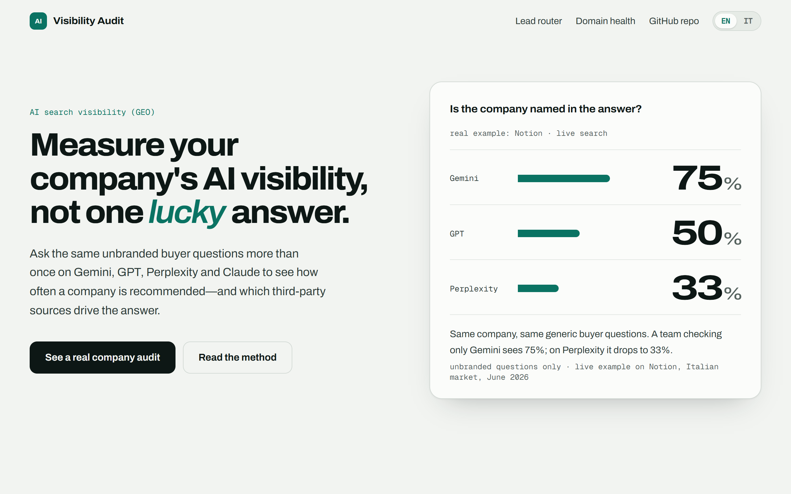
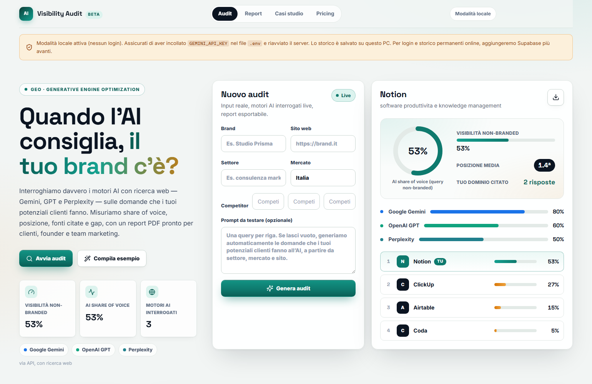
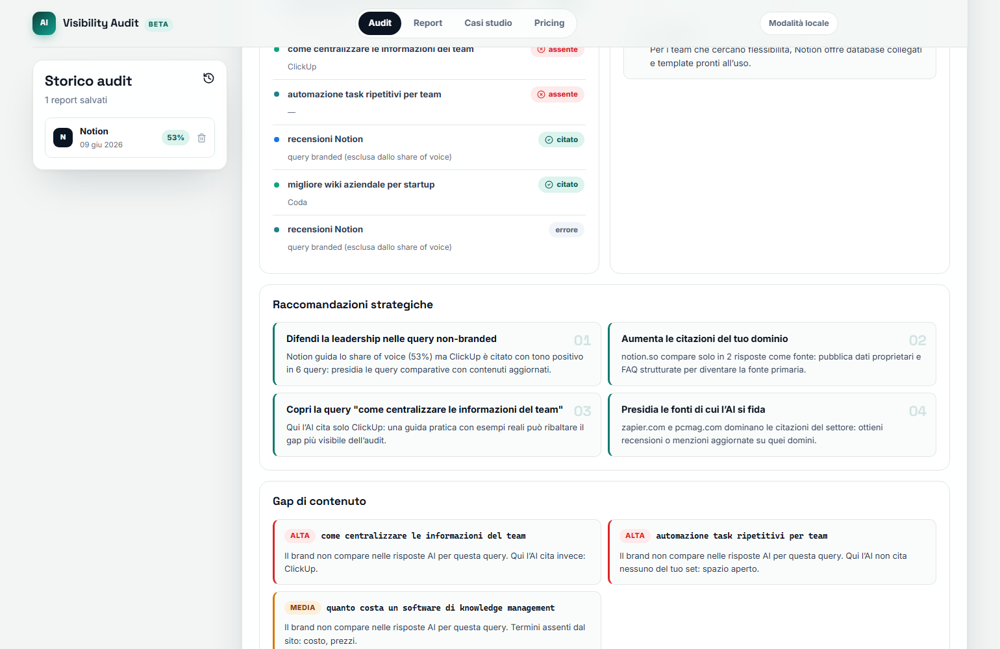

# AI Visibility Audit — GEO Methodology & Real-Brand Case Studies

> **Public Methodology & Case Study Showcase.** The full multi-tenant application behind this work is maintained in a private repository for commercial use. This repository documents the measurement framework, anti-roadmap, live product outputs, and verifiable real-brand AI search benchmarks.

**[Explore the interactive showcase page](https://errer441122.github.io/ai-visibility-audit-geo/)**

> **Live Testing & Scope:** Both real-brand datasets in this repository were collected **live**: the Notion multi-engine Share of Voice & Source Gap readout ran through the private *AI Visibility Audit* application against Google Gemini, OpenAI GPT, and Perplexity live web search; the 5-brand SaaS `robots.txt` & `/llms.txt` benchmark (`case-studies/saas-ai-crawler-benchmark.csv`) was verified live via HTTP on 2026-11-20. Commercial application source code stays private.

---

## The Business Problem

Buyers increasingly ask **ChatGPT, Google Gemini, Perplexity, and Claude** for category recommendations (*"best workspace software for startups"*, *"best CRM for e-commerce"*) before clicking a traditional Google result. Yet most marketing teams face three blind spots:

1. **Single-prompt vanity scores:** Asking an LLM once produces a lottery ticket. A 2026 paper on LLM text annotation (Camuffo, Gambardella et al., *Variance-Aware LLM Annotation for Strategy Research*, arXiv 2601.02370) found that small design choices such as prompt phrasing or model selection shift results by **12–85 percentage points**. It does not measure brand visibility, but brand-recommendation answers come from the same models, so I treat one answer as one sample, not a score.
2. **Missing the Source Layer:** B2B buyers validate AI answers on third-party sources (*Forrester, The State of Business Buying 2026*). Appearing in the **third-party domains the AI cites** matters as much as being named in the text.
3. **GA4 is blind to AI crawlers:** AI retrieval and training bots (`OAI-SearchBot`, `Claude-SearchBot`, `PerplexityBot`, `GPTBot`) do not execute JavaScript, so GA4 records zero visits from them — only server logs and `robots.txt` audits reveal whether AI engines can actually read your key pages.

---

## Core Measurement Methodology

Full specification: [`methodology/geo-measurement-framework.md`](methodology/geo-measurement-framework.md)

| Pillar | What It Measures | Why It Matters |
| --- | --- | --- |
| **Multi-Engine Live Grounding** | Queries **Google Gemini** (Google Search grounding), **OpenAI GPT** (web search), **Perplexity**, and **Anthropic Claude** | ChatGPT's share of B2B AI referrals is shifting rapidly toward Claude, Gemini, and Perplexity — single-engine tracking hides major blind spots |
| **Non-Branded Share of Voice** | Strictly separates unbranded discovery queries from branded queries | Counting branded queries ("Notion reviews") artificially inflates visibility; real acquisition happens on unbranded category intent |
| **Multi-Run & Paraphrase Stability** | Repeats each intent 2–3 times and across 1–3 prompt paraphrases | Reports explicit stability bands (*"cited in 2/3 runs"*) and flags wording-sensitive gaps instead of noisy single-run scores |
| **Source Gap Analysis** | Maps the exact third-party domains driving AI answers + month-over-month citation turnover | Turns GEO from abstract theory into concrete Digital PR, review-platform, and comparison-content actions |
| **Full-Chain Attribution (Logs → GSC → GA4)** | Connects **Server Log AI Crawler Parsing** (19 AI bots classified by Training / AI Search / User Fetch) + **Google Search Console** + **GA4 AI Referral Traffic** | Links the full funnel: *AI crawls the page → AI cites the brand → User arrives & converts* |

---

## Real-Brand Evidence in This Repository

### 1. Live Multi-Engine Audit Readout: Notion vs. ClickUp, Airtable & Coda
Full readout: [`case-studies/notion-live-audit-summary.md`](case-studies/notion-live-audit-summary.md)

- **Scope:** 15 live queries across **Google Gemini, OpenAI GPT, and Perplexity** (Italian market, productivity & knowledge management category), excluding branded queries from Share of Voice. **Small sample:** 5 queries per engine, 15 answers in all (1 provider error): read it as a direction, not a precise measurement.
- **Headline findings:**
  - **Non-branded AI Share of Voice** (each brand's share of the brand mentions inside non-branded answers): Notion **53%** (avg. position **1.4**) vs. ClickUp **27%** (avg. 2.1), Airtable **15%** (avg. 2.8), Coda **5%** (avg. 3.5).
  - **Engine divergence** (Notion named, all 5 queries per engine): Gemini **80%** · OpenAI GPT **60%** · Perplexity **50%**; on non-branded queries only, 75% · 50% · 33%. A single-engine audit would mislead.
  - **Source Gap:** `notion.so` was cited directly in only **2 answers**; third-party domains (`zapier.com` 6×, `pcmag.com` 4×, `techradar.com` 3×, `g2.com` 2×, `capterra.it` 1×) drove the majority of AI consensus.
  - **Actionable Gaps:** Completely absent on high-intent unbranded queries (*"come centralizzare le informazioni del team"*, where ClickUp won; *"automazione task ripetitivi per team"*, open whitespace; *"quanto costa un software di knowledge management"*, missing clear pricing/FAQ markup).

### 2. Live-Verified 5-Brand AI Crawler Benchmark (`robots.txt` & `/llms.txt`)
Full audit & raw CSV (verified live on **2026-11-20**): [`case-studies/saas-ai-crawler-benchmark.md`](case-studies/saas-ai-crawler-benchmark.md) · [`case-studies/saas-ai-crawler-benchmark.csv`](case-studies/saas-ai-crawler-benchmark.csv)

| Brand | Explicit AI Bot Rules in `robots.txt` | AI Search & Training Access | `/llms.txt` Status | Key Technical Observation |
| --- | --- | --- | --- | --- |
| **Asana** (`asana.com`) | **Yes — 17 named AI agents** (`OAI-SearchBot`, `GPTBot`, `ClaudeBot`, `PerplexityBot`, `Google-Extended`, etc.) | Public pages open; gated `/ebook/` & `/resources/thank-you` blocked | **200 OK** (24.7 KB) | Most mature AI-agent governance in the peer group |
| **Notion** (`notion.so`) | Partial (`Amazonbot` explicitly disallowed; other AI bots allowed via `*`) | Open (11 segmented sitemaps incl. `/md/sitemap.xml`) | **200 OK** (6.8 KB) | Publishes a dedicated Markdown sitemap while blocking SEO scrapers (`AhrefsBot`, `SemrushBot`) |
| **ClickUp** (`clickup.com`) | Wildcard (`User-agent: * Allow: /`) | Open; explicitly blocks `*utm_*`, `*fbclid=`, `*gclid=` | **200 OK** (8.8 KB) | Protects crawl budget from parameterized marketing URLs |
| **Airtable** (`airtable.com`) | Minimal wildcard (6 rules) | Open (`/studio/`, `/api/` blocked) | **404 Not Found** | No explicit AI crawler segmentation |
| **Coda** (`coda.io`) | Minimal wildcard (6 rules) | Open (`/docs`, `/d/` user workspaces blocked) | **404 Not Found** | Protects user documents without dedicated AI crawler rules |

---

## What I Deliberately Left Out (Anti-Roadmap)

Methodological honesty is what makes GEO reporting defensible in executive meetings:

1. **No fake "Prompt Volume" estimates:** AI platforms do not publish prompt search volumes. Reporting invented volume numbers breaks trust.
2. **No `llms.txt` hype score:** Independent crawl studies (Ahrefs, June 2026) found ~97% of `llms.txt` files receive zero bot discovery requests; I log it as an informational observation, never as a primary ranking KPI.
3. **No autonomous AI CMS publishing:** Publishing unreviewed AI articles damages B2B brand authority; the output is structured editorial briefs and 4-week execution plans reviewed by humans.
4. **Honest measurement boundaries:** API responses with live web search closely reflect real citation sources, but differ slightly from personalized consumer chat sessions; GA4 AI referral traffic is always reported as a **minimum floor** (many AI surfaces strip referrers).

---

## Repository Structure

| Path | Content |
| --- | --- |
| [`methodology/geo-measurement-framework.md`](methodology/geo-measurement-framework.md) | Complete GEO measurement protocol, 19-bot AI crawler taxonomy, GA4/GSC/Server-log funnel, and anti-roadmap |
| [`methodology/api-unit-economics.md`](methodology/api-unit-economics.md) | Transparent public API cost model per audit (`engines × queries × runs`) and monthly cadence rationale |
| [`case-studies/notion-live-audit-summary.md`](case-studies/notion-live-audit-summary.md) | Detailed breakdown of the live multi-engine Notion audit and 4-week remediation plan |
| [`case-studies/saas-ai-crawler-benchmark.md`](case-studies/saas-ai-crawler-benchmark.md) | Live-verified `robots.txt` & `/llms.txt` technical audit across Notion, ClickUp, Airtable, Coda, and Asana |
| [`assets/`](assets/) | Real product UI and live report screenshots |
| [`docs/index.html`](docs/index.html) | Interactive executive showcase page served via GitHub Pages |

## License

Documentation and case studies: MIT. Product source code remains private.
