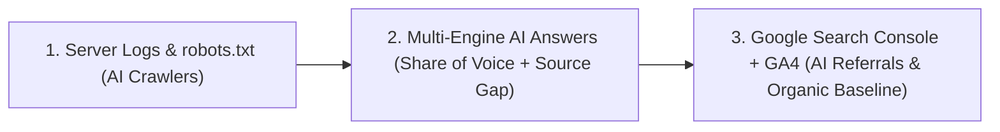

# GEO Measurement Framework & Methodological Standards

This document defines the measurement rules behind **AI Visibility Audit** — designed so every metric survives executive and procurement scrutiny without vanity numbers.

---

## 1. Controlling LLM Variance (Why Single-Run Scores Fail)

Large Language Models are probabilistic. Asking *"What is the best CRM for small e-commerce brands?"* once can mention Brand A on Monday and omit it on Tuesday.

To turn AI visibility into a defensible KPI, the methodology enforces three controls:

1. **Locked query sets for longitudinal tracking:** Month-over-month comparisons always re-run the exact same set of category queries, separating real progress from prompt drift.
2. **Multi-run sampling (2–3 repetitions per query):** Instead of binary pass/fail, every query reports consistency (e.g., *"cited in 2/3 runs"*) and renders a **stability band** on trend charts.
3. **Prompt-variant paraphrasing (1–3 formulations per intent):** Borrowed from LLM annotation research (Camuffo, Gambardella et al., arXiv 2601.02370, which found that prompt phrasing alone can shift results by 12–85 points), testing paraphrases of the same buyer intent surfaces **wording-sensitive ("fragile") gaps** — queries where a brand appears under one phrasing and disappears under another.

---

## 2. Strict Separation of Branded vs. Non-Branded Queries

- **Branded queries** (e.g., *"Notion pricing"*, *"Notion reviews"*) measure reputation & factual accuracy, **never** acquisition Share of Voice.
- **Non-branded category queries** (e.g., *"best knowledge base for startups"*) are the sole denominator for **AI Share of Voice** and **Non-Branded Visibility Rate**.

---

## 3. The 3-Layer Attribution Chain (Crawlers → Citations → Visits)

### Layer 1: AI Crawler Taxonomy (19 Vendor-Documented User-Agents)
Because AI crawlers do not execute JavaScript, GA4 cannot record them. Server logs (Nginx/Apache Combined Log Format or Cloudflare Logpush JSON) are classified into three vendor-defined purposes:

| Purpose | Example Crawlers Tracked | Business Meaning |
| --- | --- | --- |
| **AI Search Indexing** | `OAI-SearchBot`, `Claude-SearchBot`, `PerplexityBot`, `Google-CloudVertexBot`, `DuckAssistBot` | Feeds live retrieval indexes behind AI search answers — **blocking these kills real-time citations** |
| **Live User Fetch** | `ChatGPT-User`, `Claude-User`, `Perplexity-User`, `Meta-ExternalFetcher`, `MistralAI-User` | Triggered in real time when a user asks the assistant to inspect a URL or compare live pricing |
| **Model Training** | `GPTBot`, `ClaudeBot`, `Google-Extended`, `Applebot-Extended`, `Meta-ExternalAgent`, `Amazonbot`, `Bytespider`, `CCBot` | Feeds base model training corpora — can be governed separately from live search bots |

*Methodological disclosure:* User-agent classification reflects the **declared** user-agent string (full cryptographic spoofing verification requires reverse-DNS / vendor IP range matching).

### Layer 2: Source Gap (Third-Party Domains Driving Consensus)
Forrester (*The State of Business Buying 2026*) highlights that B2B buyers distrust unverified AI summaries and validate recommendations on trusted third-party sources. Tracking **which external domains are cited across engines** — and how those citations rotate month over month — turns GEO into concrete PR, directory, and comparison-page ownership.

### Layer 3: GA4 & Google Search Console (Honest Baselines)
- **GA4 AI Referral Traffic:** Reported explicitly as a **guaranteed floor**, because many mobile/in-app AI experiences strip HTTP referrers. Focus is placed on **conversion quality per visit**, not raw click volume.
- **Google Search Console:** Paired beside AI visibility using the same branded/non-branded split to highlight where traditional Google rankings diverge from AI citations.

---

## 4. Honest Limitations & Anti-Roadmap

| Excluded Feature | Reason Excluded |
| --- | --- |
| **Synthetic "Prompt Volume" estimates** | No AI vendor publishes prompt search volumes; claiming exact monthly prompt counts is unverifiable guesswork |
| **`llms.txt` as a primary KPI** | Empirical crawl studies (Ahrefs, June 2026) show ~97% of `llms.txt` files receive no bot requests; tracked only as an informational note |
| **Unreviewed autonomous AI publishing** | Auto-publishing AI text risks factual errors and brand dilution; the tool produces structured briefs for human editors |
| **Claiming API = Consumer Chat UI** | Live search APIs (Gemini Google Search grounding, Perplexity Sonar, OpenAI/Claude web search) reflect real retrieval sources, but consumer chats add account personalization and memory — always disclosed in every report |
